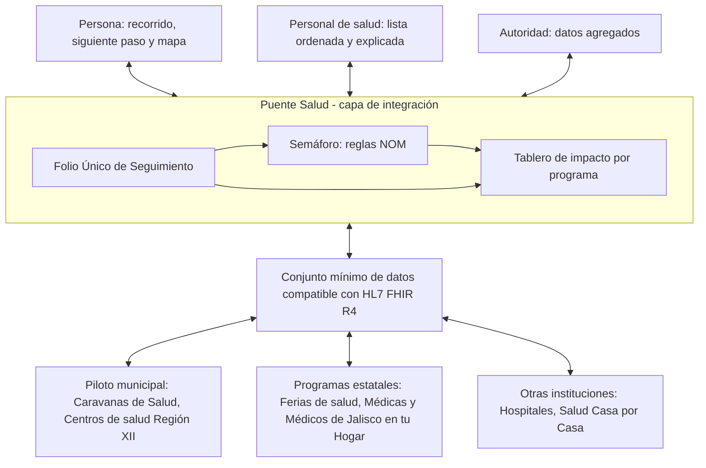

# Puente Salud: continuidad de la atención de la diabetes y la hipertensión en San Pedro Tlaquepaque, Jalisco

## Resumen

En Jalisco, la mortalidad por diabetes alcanza 64.3 por cada 100 mil habitantes (Coparmex Jalisco, 2026) y, en México, solo 25.8% de las personas con diabetes diagnosticada logra controlarla (Basto-Abreu et al., 2024). En San Pedro Tlaquepaque, el reto no es solo detectar sino dar continuidad a la atención: ferias de salud, Médicas y Médicos de Jalisco en tu Hogar, Caravanas municipales y Salud Casa por Casa operan en paralelo y con registros separados, por lo que se cuentan personas atendidas, no personas que llegan al control.

Este trabajo presenta Puente Salud, un producto mínimo viable que apoya la continuidad de la atención de las personas con diabetes e hipertensión. Reúne un Folio Único de Seguimiento que reconstruye el recorrido de cada persona sin reemplazar los sistemas de cada programa, un semáforo que ordena a quién buscar primero y explica por qué, y un tablero de impacto que mide cuántas personas lleva cada programa al control.

La investigación es descriptiva y de diseño. Una revisión multivocal (Garousi et al., 2019) seleccionó 13 fuentes de 53 candidatos: la pérdida ocurre después de la detección, y funcionan el registro nominal y los promotores, no los mensajes aislados. Se integraron cinco fuentes oficiales abiertas (INEGI, CONEVAL y CLUES) en un tablero de contexto de Tlaquepaque, y las reglas del semáforo se basan en las NOM-015-SSA2-2010 y NOM-030-SSA2-2009.

El prototipo usa herramientas de código abierto, un modelo de datos compatible con HL7 FHIR, tres vistas (persona, personal de salud y autoridad) y pacientes simulados, sin datos personales reales. Funciona con reglas explicables y deja la decisión al personal de salud; un modelo de riesgo de abandono queda como trabajo futuro.

Aunque en Tlaquepaque no pudo comprobarse dónde se pierden las personas porque los datos no son públicos, Puente Salud propone cambiar la pregunta institucional: de cuántas personas se atendieron a cuántas llegaron al control.

## 1. INTRODUCCIÓN

### 1.1 Contexto

La diabetes y la hipertensión son enfermedades crónicas que exigen seguimiento continuo, y su control depende de que cada persona detectada sea atendida de forma sostenida. En San Pedro Tlaquepaque, varios programas de salud detectan casos, pero operan en paralelo y con registros separados, por lo que no es posible saber cuántas personas llegan al control. Este trabajo propone Puente Salud, una herramienta digital que conecta el recorrido de cada persona entre programas sin reemplazar sus sistemas. El documento presenta el problema, los objetivos y el supuesto (sección 1), el marco teórico (2), la metodología (3), los resultados (4), la discusión (5) y la conclusión (6); los anexos B a G detallan la revisión de literatura, los datos, el semáforo, el diseño, la viabilidad y el uso de IA.

### 1.2 Problema

En Jalisco, la mortalidad por diabetes alcanza 64.3 por cada 100 mil habitantes y, en el Área Metropolitana de Guadalajara, la diabetes y la hipertensión afectan al 13.4% y 17.7% de la población (Coparmex Jalisco, 2026). En México, solo 25.8% de las personas diagnosticadas con diabetes la controla (Basto-Abreu et al., 2024), y quienes no tienen seguridad social se diagnostican tarde (Reyes-García et al., 2025).

En Tlaquepaque, el reto no es detectar, sino dar continuidad a la atención. Ferias de salud, Médicas y Médicos de Jalisco en tu Hogar, Caravanas municipales y Salud Casa por Casa operan en paralelo, este último con expediente propio (N+, 2025), y con brechas tecnológicas entre niveles de atención (OPD SSJ, 2025). Así, una detección puede no traducirse en seguimiento.

Además, la Región Sanitaria XII tiene la menor tasa de médicos públicos evaluada (0.14 por mil habitantes) y bases de datos incompletas impiden evaluar las campañas preventivas (Jalisco Cómo Vamos et al., 2025): se cuentan personas atendidas, no cuántas alcanzan el control.

<!-- VERIFICAR: "Coparmex Jalisco, 2026" y "Jalisco Cómo Vamos et al., 2025" parecen ser la misma fuente (S13). Unificar nombre y año. -->

### 1.3 Objetivos

#### 1.3.1 General

Diseñar un producto mínimo viable de Puente Salud, una herramienta digital que apoye la continuidad de la atención de las personas con diabetes e hipertensión detectadas por los programas de salud de Tlaquepaque.

#### 1.3.2 Específicos

1. Analizar, mediante una revisión multivocal, en qué etapas de la atención se pierden estas personas y qué estrategias de seguimiento son efectivas.
2. Integrar cinco conjuntos de datos oficiales (defunciones del INEGI, Censo 2020, Marco Geoestadístico, rezago social de CONEVAL y CLUES) para caracterizar ambas enfermedades e identificar las zonas con mayor necesidad y menor acceso a unidades de salud.
3. Definir los datos mínimos del recorrido y las reglas del semáforo de seguimiento con base en las NOM aplicables (NOM-015-SSA2-2010 y NOM-030-SSA2-2009).
4. Desarrollar un prototipo funcional con la integración del recorrido, el semáforo y el tablero de impacto por programa.

### 1.4 Supuesto metodológico

Por ser un trabajo descriptivo y de diseño, se plantea un supuesto y no una hipótesis: integrar gradualmente, con un conjunto mínimo de datos, los registros separados de cada programa permite reconstruir el recorrido de cada persona, priorizar su seguimiento con criterios explicables y medir el resultado de cada programa.

**Pregunta rectora.** ¿Cómo puede una herramienta de integración gradual apoyar la continuidad de la atención de las personas con diabetes e hipertensión detectadas en Tlaquepaque?

**Preguntas complementarias.** ¿En qué etapas se pierden estas personas y qué seguimiento mejora su control? ¿Qué datos mínimos, reglas de priorización y principios éticos necesita la herramienta?

### 1.5 Justificación

Cada persona que se pierde entre la detección y el control enfrenta complicaciones evitables y mayores gastos, sobre todo en hogares con adultos mayores (Oliva et al., 2026). Integrar la información entre instituciones reduce duplicidades, costos y riesgos (Menachemi et al., 2018), y Uruguay muestra que es posible sin un expediente único: con un modelo federado y gradual, cubre al 95% de su población (Friedmann y Caredio, 2022). Ante la escasez de médicos, priorizar a quienes enfrentan más barreras es una cuestión de equidad; a futuro, un modelo explicable podría anticipar el abandono del tratamiento, siempre bajo supervisión humana (OMS, 2021).

## 2. CONTEXTO TEÓRICO

### 2.1 Proceso de atención

El proceso de atención comprende detección, diagnóstico, tratamiento y control, y en cada etapa se pierde parte de la población. En hipertensión, solo 60.1% de los tratados logra el control (Campos-Nonato et al., 2025). Este marco permite ubicar y medir dónde se rompe la atención.

### 2.2 Registro nominal

Un registro nominal sigue el avance de cada persona, en lugar de contar atenciones. En México, el modelo CASALUD lo incorporó y se asoció con mejor control de la diabetes (Tapia-Conyer et al., 2017; Lozano et al., 2021). Los promotores mejoraron la presión arterial y la adherencia (Mbuthia et al., 2022), mientras que los mensajes de texto aislados tuvieron poco efecto (Mokaya et al., 2022; Van Olmen et al., 2017).

### 2.3 Interoperabilidad federada

La interoperabilidad es la capacidad de distintos sistemas para intercambiar información; en México, ni los expedientes que cumplen la NOM-024-SSA3-2012 lo logran (Morales-Rocha et al., 2020). Los modelos federados conectan instituciones sin centralizar datos y se adoptan por etapas, como en Uruguay y Tanzania (Friedmann y Caredio, 2022; Nsaghurwe et al., 2021).

### 2.4 IA explicable

La IA que apoya decisiones de salud debe explicar sus resultados y dejar la decisión final al personal (Amann et al., 2020; OMS, 2021).

## 3. METODOLOGÍA

**Enfoque.** Investigación descriptiva y de diseño en tres etapas, que integra salud pública (proceso de atención y criterios clínicos), ciencia de datos (cruce de fuentes y pacientes simulados), ingeniería de software (capa de integración con un modelo de datos compatible con HL7 FHIR) y ética (protección de datos y supervisión humana).

**Revisión multivocal (objetivo 1).** Siguiendo a Garousi et al. (2019), se plantearon cuatro preguntas de investigación y siete cadenas de búsqueda; de 53 candidatos, se seleccionaron 13 fuentes con criterios de inclusión, exclusión y calidad, integradas por síntesis narrativa (Popay et al., 2006; Anexo B).

**Datos y reglas (objetivos 2 y 3).** Se integraron las defunciones del INEGI, el Censo 2020 por AGEB, el Marco Geoestadístico, el rezago social de CONEVAL y el CLUES mediante la clave geoestadística de la AGEB; las unidades de salud se ubican de forma aproximada por localidad. Los pacientes simulados se parametrizaron con las prevalencias y tasas publicadas a partir de la Ensanut, representativa solo por región (Basto-Abreu et al., 2024; Campos-Nonato et al., 2025; Anexo C). Las reglas del semáforo se basaron en los criterios de control de ambas NOM y en definiciones operativas de abandono, pérdida en la confirmación y riesgo de abandono (Anexo D).

**Prototipo (objetivo 4).** Se construyó con herramientas gratuitas o de código abierto y pacientes simulados (Anexos C y E).

## 4. RESULTADOS

**Revisión de literatura (objetivo 1).** La pérdida ocurre después de la detección: solo 5.47% de los tamizados por MIDO se vinculó con su centro de salud (Lozano et al., 2021). Funcionan el registro nominal y los promotores, no los mensajes aislados (Mbuthia et al., 2022; Mokaya et al., 2022). En la región Pacífico-Centro, que agrupa a Jalisco, Colima y Michoacán, el control glucémico es menor de 30% (Reyes-García et al., 2025), y ninguna fuente reporta cuántos detectados en Tlaquepaque llegan al control.

**Diseño de la solución.** La integración del recorrido conecta los registros de cada programa sin reemplazarlos; el semáforo ordena a quién buscar primero y explica por qué, pero decide el personal, y el tablero de impacto mide cuántas personas lleva cada programa al control. En ética, se comparte lo mínimo con consentimiento y acceso por rol, el semáforo prioriza a quien enfrenta más rezago social y cada sugerencia queda registrada para auditoría (Anexo E.5).

**Datos y reglas (objetivos 2 y 3).** El tablero de contexto presenta la mortalidad municipal por ambas enfermedades (cifras y tendencia) y, en un mapa por AGEB, la población de 18 años y más sin afiliación, el grado de rezago social y la ubicación aproximada de las unidades de salud, para señalar las zonas de mayor necesidad y menor acceso.

**Prototipo (objetivo 4).** Registra el recorrido de cada persona, le asigna un nivel de semáforo explicado y calcula los cuatro indicadores de éxito por programa (Anexo E).

## 5. DISCUSIONES

La evidencia confirma que el problema es de continuidad, con límites: el dato de vinculación proviene de un solo programa y la relación del registro nominal con el control es una asociación, reportada por autores comunes. Ningún estudio evalúa un semáforo como el propuesto, que no sustituye al personal faltante, solo ayuda a usarlo mejor.

La viabilidad depende de que las instituciones conecten sus registros: cada programa conservaría su información y compartiría solo los datos mínimos, conforme a la NOM-024-SSA3-2012, sumándose gradualmente desde un piloto municipal. Los retos principales no son técnicos: acuerdos interinstitucionales, brecha digital y calidad del registro (Anexo F).

## 6. CONCLUSIÓN

La evidencia nacional y regional indica que las personas se pierden después de la detección, pero en Tlaquepaque no pudo comprobarse porque los datos no son públicos. Esa ausencia es en sí un hallazgo: sin un registro que siga a cada persona, nadie sabe qué programa lleva a la gente al control. Puente Salud responde a la pregunta rectora: conecta ese recorrido sin reemplazar sistemas, ordena el seguimiento con reglas explicables que dan sus razones y deja la decisión al personal, y mide el resultado de cada programa. Su aporte es cambiar la pregunta institucional: de cuántas personas se atendieron a cuántas llegaron al control.

### 6.1 Trabajo futuro

El siguiente paso es un piloto en las Caravanas de Salud y centros de la Región Sanitaria XII que mida los cuatro indicadores y, con datos reales, entrene el modelo de riesgo de abandono sin sesgos por sexo, edad o colonia. Después, Puente Salud podría escalar sin rediseñarse a otros municipios, instituciones y enfermedades crónicas.

## 7. BIBLIOGRAFÍA

<!-- PENDIENTE DEL EQUIPO: referencias en formato APA 7, en orden alfabético, para cada cita del texto. Fuentes citadas: Amann et al. (2020); Basto-Abreu et al. (2024); Campos-Nonato et al. (2025); Colchero et al. (2020); Coparmex Jalisco (2026) / Jalisco Cómo Vamos et al. (2025); Friedmann y Caredio (2022); Garousi et al. (2019); Lozano et al. (2021); Mbuthia et al. (2022); Menachemi et al. (2018); Mokaya et al. (2022); Morales-Rocha et al. (2020); N+ (2025); Nsaghurwe et al. (2021); OMS (2021); Oliva et al. (2026); OPD SSJ (2025); Popay et al. (2006); Reyes-García et al. (2025); Tapia-Conyer et al. (2017); Van Olmen et al. (2017). Las normas (NOM-015-SSA2-2010, NOM-030-SSA2-2009, NOM-024-SSA3-2012) se citan con su fecha de publicación en el DOF. -->

---

## ANEXOS

## Anexo B. Revisión de literatura multivocal

### B.1 Preguntas de investigación

| PI | Pregunta |
|---|---|
| PI1 | ¿En qué etapas del proceso de atención de la diabetes y la hipertensión (detección, diagnóstico, tratamiento y control) se pierden las personas en México, y qué factores se asocian? |
| PI2 | ¿Qué estrategias de seguimiento (registros nominales, promotores, intervenciones móviles) mejoran la continuidad y el control, y cuáles no? |
| PI3 | ¿Qué principios éticos, legales y técnicos deben cumplir las herramientas digitales que priorizan el seguimiento, incluida la IA? |
| PI4 | ¿Qué evidencia existe sobre la oferta de servicios, los programas y la continuidad de la atención en Jalisco, el AMG y Tlaquepaque? |

### B.2 Búsqueda, selección y calidad

**Cadenas.** Se ejecutaron en Google y Google Scholar.

| Cadena | Tipo | PI | Texto de búsqueda |
|---|---|---|---|
| SS-1 | Blanca | PI1 | diabetes care cascade Mexico screening diagnosis treatment control |
| SS-2 | Blanca | PI1 | hypertension awareness treatment control Mexico Ensanut |
| SS-3 | Blanca | PI2 | community health workers interventions retention diabetes hypertension low middle income countries systematic review |
| SS-4 | Blanca | PI2 | mHealth type 2 diabetes low middle income countries systematic review |
| SS-5 | Blanca | PI3 | explainable artificial intelligence clinical decision support human oversight ethics primary care |
| SS-6 | Gris | PI4 | monitoreo sistema de salud Jalisco médicos tiempo de espera región sanitaria |
| SS-7 | Gris | PI3 | ethics and governance of artificial intelligence for health guidance |

**Criterios.** Inclusión: publicada entre 2015 y 2026, en español o inglés, con autor u organización identificable, relacionada con una PI, que la responde con resultados y con calidad de 4 o más sobre 6. Exclusión: sin fecha, blog, opinión o promoción, duplicado, o edición anterior de una Ensanut ya incluida. Parada: diez resultados seguidos sin conceptos nuevos, o 200 resultados.

**Selección.** Se vieron 77 resultados y 6 búsquedas dirigidas; tras quitar 30 duplicados quedaron 53 candidatos. Etapa 1 (fecha e idioma): 52. Etapa 2 (autor y título): 43. Etapa 3 (resumen): 29. Etapa 4 (lectura y calidad): 13 fuentes; se descartaron 16 por no responder una pregunta de investigación o por no alcanzar 4 sobre 6 en calidad.

**Calidad.** Se calificaron autoridad del autor y de la organización, objetividad, respaldo, profundidad y tipo de fuente (máximo 6). S01 a S12 obtuvieron 6 y S13 obtuvo 4.

**Limitaciones.**

- No se alcanzó ningún criterio de parada y no se hizo rastreo de referencias.
- S04, S06, S07, S08 y S11 se leyeron en su resumen.

### B.3 Fuentes incluidas

Cada fuente aporta una cita textual con su ubicación.

| ID | Fuente | Vía | PI | Cita textual (ubicación) |
|---|---|---|---|---|
| S01 | Basto-Abreu et al. (2024). Salud Pública de México, 66, 528–536. DOI 10.21149/16209 | SS-1 | PI1, PI2 | «El control glucémico fue observado en sólo 25.8% de las personas con diabetes diagnosticada.» (p. 534) |
| S02 | Reyes-García et al. (2025). Salud Pública de México, 67, 622–632. DOI 10.21149/17286 | B-D | PI1, PI4 | «las personas sin seguridad social tienen mayor riesgo de diagnóstico tardío» (p. 623) |
| S03 | Campos-Nonato et al. (2025). Salud Pública de México, 67, 633–643. DOI 10.21149/17102 | SS-2 | PI1, PI4 | «El 62.9% de los adultos con hipertensión ya había sido diagnosticado» (p. 633) |
| S04 | Lozano et al. (2021). BMJ Open, 11(9), e049836. DOI 10.1136/bmjopen-2021-049836 | SS-1 | PI1, PI2 | «Only 5.47% (n=17 774) of individuals were linked with their corresponding primary health centre.» (Resumen) |
| S05 | Tapia-Conyer et al. (2017). Int. J. of Health Policy and Management, 6(6), 339–344. DOI 10.15171/ijhpm.2017.18 | SS-1 | PI2 | «in order to shift from paper-based records to nominal information systems» (descripción de MIDO, párr. 6) |
| S06 | Mbuthia et al. (2022). BMJ Open, 12, e053455. DOI 10.1136/bmjopen-2021-053455 | SS-3 | PI2 | «The interventions had positive effects in the BP reduction, linkage to care, treatment adherence» (Resumen) |
| S07 | Mokaya et al. (2022). Int. J. of Behavioral Nutrition and Physical Activity, 19. DOI 10.1186/s12966-021-01238-0 | SS-4 | PI2 | «had a percentage difference of <0.3% between the mHealth intervention and the comparison group» (Resumen) |
| S08 | Van Olmen et al. (2017). J. of Clinical and Translational Endocrinology, 7, 33–41. DOI 10.1016/j.jcte.2016.12.005 | B-D | PI2 | «The finding that text messages did not show an additional effect on diabetes control» (Resumen) |
| S09 | Colchero et al. (2020). Salud Pública de México, 62, 851–858. DOI 10.21149/11547 | B-D | PI1 | «Derechohabiencia y afiliación no garantizan el acceso a la atención médica en servicios públicos.» (p. 851) |
| S10 | Oliva et al. (2026). Salud Pública de México, 68, 107–115. DOI 10.21149/17222 | B-D | PI1 | «los hogares con adultos mayores gastan más, con una brecha creciente desde 2012» (p. 107) |
| S11 | Amann et al. (2020). BMC Medical Informatics and Decision Making, 20, 310. DOI 10.1186/s12911-020-01332-6 | SS-5 | PI3 | «omitting explainability in clinical decision support systems poses a threat to core ethical values» (p. 1) |
| S12 | OMS (2021). Ethics and governance of artificial intelligence for health. ISBN 9789240029200 | SS-7 | PI3 | «humans should remain in control of health-care systems and medical decisions» (Resumen ejecutivo, principio 1) |
| S13 | Jalisco Cómo Vamos, Coparmex Jalisco y Tec de Monterrey. Monitoreo al Sistema de Salud Jalisco | B-D | PI4 | «Persisten brechas en médicos en contacto con pacientes; ninguna región alcanza el estándar OCDE» (Hallazgos) |

### B.4 Respuestas a las preguntas de investigación

| PI | Lo que reportan las fuentes |
|---|---|
| PI1 | Detección: 27.7% de los adultos elegibles se tamizó en el último año; entre 5.4% y 6.0% de los adultos tiene diabetes sin diagnóstico (S01, S02); 62.9% de los adultos con hipertensión ya tenía diagnóstico (S03). Vinculación: 5.47% de los tamizados por MIDO se vinculó con su centro de salud (S04). Atención: 72.8% de las personas con diabetes diagnosticada visitó al médico en el último año (S01). Control: 25.8% (S01) y 33.0% (S02) en diabetes; 60.1% de las personas tratadas por hipertensión (S03). Factores: sin seguridad social, mayor riesgo de diagnóstico tardío (S02); los consultorios de farmacia se asocian con menor uso de servicios públicos (S09); los hogares con adultos mayores gastan más de su bolsillo (S10). |
| PI2 | Con efecto positivo: el modelo CASALUD, con registro nominal, se asoció con más control de la diabetes (razón de momios 1.32) (S04); los promotores mejoraron la presión, el vínculo con la atención y la adherencia en 14 estudios (S06). Sin efecto adicional: mensajes de texto agregados a la atención de rutina (S08). Diferencias pequeñas: menos de 0.3% en HbA1c en 10 de 12 estudios móviles (S07). Sin medición de efecto: MIDO, con registro nominal y tablero público diario (S05). |
| PI3 | Control humano de las decisiones (S12); explicabilidad (S11, S12); privacidad y consentimiento informado (S12); diseño equitativo, sin excluir por edad, sexo o ingreso (S12). |
| PI4 | Control glucémico menor de 30% en la región Pacífico-Centro, que agrupa a Jalisco, Colima y Michoacán (S02); prevalencia de hipertensión de 24.4% en Jalisco (S03); ninguna región de Jalisco alcanza el estándar OCDE de 3.5 médicos por cada mil habitantes; el tiempo de espera es lo peor calificado en 2016, 2022 y 2024; 696 centros de salud en 2024 (S13). |

### B.5 Síntesis de los datos

Los hallazgos se integraron mediante síntesis narrativa (Popay et al., 2006): las citas de B.3 se agruparon por pregunta, se codificaron en temas y se contrastaron entre literatura blanca y gris.

| PI | Tema | Fuentes |
|---|---|---|
| PI1 | Pérdida en la detección y entre la detección y el vínculo con el centro de salud | S01, S03, S04 |
| PI1 | Control bajo pese a diagnóstico y tratamiento | S01, S02, S03 |
| PI1 | Barrera económica, falta de seguridad social y atención fuera del sistema público | S02, S09, S10 |
| PI2 | Registro nominal y promotores con efecto positivo reportado | S04, S05, S06 |
| PI2 | Mensajes y aplicaciones: sin efecto adicional o diferencias pequeñas en HbA1c | S07, S08 |
| PI3 | Control humano de las decisiones y explicabilidad | S11, S12 |
| PI4 | Control bajo en Jalisco y en la región Pacífico-Centro | S02, S03 |
| PI4 | Médicos por debajo del estándar de la OCDE y tiempos de espera en Jalisco | S13 |

La literatura blanca aporta la magnitud de la pérdida en cada etapa (PI1) y la evidencia sobre qué funciona (PI2); la gris aporta el marco ético (PI3) y el contexto de Jalisco (PI4). S04 y S05 provienen del mismo modelo, CASALUD, y comparten autores.

---

## Anexo C. Datos y fuentes del prototipo

Los conjuntos de datos se consultaron el 16 de noviembre de 2026.

| Conjunto de datos | Fuente | Catálogo del hackathon | Uso en el prototipo | Consulta |
|---|---|---|---|---|
| Defunciones registradas, 2023–2025 | INEGI, Estadísticas de Defunciones Registradas | N.º 12 | Mortalidad municipal por diabetes (CIE-10 E10–E14) e hipertensión (I10–I15) en Tlaquepaque, para cifras y tendencia del tablero de contexto | https://www.inegi.org.mx/programas/edr/#datos_abiertos |
| Población y vivienda por AGEB | INEGI, Censo de Población y Vivienda 2020 | No | Población de 18 años y más sin afiliación a servicios de salud, y con discapacidad, por AGEB | https://www.inegi.org.mx/programas/ccpv/2020/ |
| Marco Geoestadístico (AGEB urbanas) | INEGI, edición dic. 2025 | No | Polígonos de las 234 AGEB de Tlaquepaque para el mapa, unidos al Censo por clave | https://www.inegi.org.mx/programas/mg/ |
| Grado de rezago social por AGEB urbana, 2020 | CONEVAL | No | Equidad en el semáforo y en el mapa | https://www.coneval.org.mx/Medicion/IRS/Paginas/Rezago_social_AGEB_2020.aspx |
| Unidades de salud, cierre 2024 | DGIS, Catálogo CLUES | N.º 13 | Listado de unidades públicas de Tlaquepaque y asignación de cada folio; ubicación aproximada por localidad en el mapa | http://www.dgis.salud.gob.mx/contenidos/intercambio/clues_gobmx.html |
| Criterios de control y clasificación | NOM-015-SSA2-2010 y NOM-030-SSA2-2009 | No | Cortes clínicos del semáforo (Anexo D) | https://www.dof.gob.mx |
| Pacientes simulados | Generados por el equipo | No | Prueba del flujo de folios, semáforo y tablero; se parametrizan con las prevalencias y tasas publicadas a partir de la Ensanut (S01, S03) | No aplica |

---

## Anexo D. Reglas del semáforo de seguimiento

El semáforo asigna a cada persona un nivel de prioridad (verde, amarillo, rojo o gris) según tres dimensiones: control clínico, seguimiento y riesgo de abandono, y toma la más grave. Los cortes clínicos provienen de las normas; los plazos y las definiciones de abandono son supuestos del proyecto, configurables. El semáforo ordena a quién buscar primero y explica por qué, pero no diagnostica: la decisión es del personal de salud.

### D.1 Cortes clínicos

Se usaron la NOM-015-SSA2-2010 y la NOM-030-SSA2-2009 (DOF, 31 de mayo de 2010). El PROY-NOM-030-SSA2-2017 es un proyecto, no una norma vigente, y propone metas distintas; se consultó solo como referencia.

| Criterio | Valor | Fuente |
|---|---|---|
| Hipertensión en control | PA menor de 140/90 mmHg (menor de 130/80 con diabetes) | NOM-030-SSA2-2009, 3.7; NOM-015-SSA2-2010, 11.11.7.3 |
| Hipertensión grado 3 | PAS mayor de 180 o PAD mayor de 110 mmHg | NOM-030-SSA2-2009, 6.1 |
| Diabetes en control | Glucosa en ayuno de 70 a 130 mg/dl o HbA1c menor de 7% | NOM-015-SSA2-2010, 3.10 |
| HbA1c | Al menos una vez al año | NOM-015-SSA2-2010, 11.11.1.4 |

Las normas no fijan cortes numéricos de urgencia, intervalos de consulta para pacientes diagnosticados ni una definición de abandono; esos elementos son supuestos del proyecto (D.2).

### D.2 Definiciones y plazos por defecto

Son supuestos del proyecto y se pueden ajustar por programa.

| Elemento | Valor por defecto |
|---|---|
| Confirmación diagnóstica | 15 a 30 días tras el tamizaje (la NOM exige esperar dos semanas) |
| Pérdida en la confirmación | Sin confirmar a los 90 días |
| Consulta de control | Cada 30 días sin control; cada 3 meses con control |
| Consulta vencida | Pasó el plazo; más de 30 días vencida se considera grave |
| Abandono | Sin consulta de control en 12 meses |
| Riesgo de abandono alto | Dos o más de: dos citas perdidas seguidas, sin afiliación a servicios de salud, AGEB de rezago Alto o Muy alto, consulta vencida |

### D.3 Asignación del nivel

El nivel final es el más grave de las tres dimensiones. El gris se asigna solo si no hay ninguna medición clínica y nunca se muestra como verde.

| Nivel | Condición |
|---|---|
| Verde | En control, consulta dentro del plazo y sin alertas |
| Amarillo | Fuera de control en la última medición; HbA1c con más de 12 meses; consulta vencida hasta 30 días; sin confirmar a los 30 días; riesgo de abandono alto |
| Rojo | PA mayor de 180/110; fuera de control en dos mediciones seguidas; consulta vencida más de 30 días; abandono; pérdida en la confirmación |
| Gris | Sin ninguna medición clínica registrada |

Cada nivel muestra las reglas que lo produjeron en lenguaje sencillo (por ejemplo, «Rojo: sin consulta de control hace 13 meses»), y el personal puede registrar su desacuerdo para auditoría (Anexo E.5). Una glucosa menor de 70 mg/dl se marca como fuera de control con la leyenda «requiere valoración del personal».

En conclusión, el semáforo convierte cortes clínicos verificables en un orden de prioridad explicable, y separa lo que viene de la norma de lo que es supuesto, para poder revisarlo y ajustarlo sin rediseñar el prototipo.

---

## Anexo E. Diseño del prototipo

### E.1 Arquitectura

Puente Salud es una capa de integración que no reemplaza los sistemas de cada programa. Las tres personas usuarias (persona, personal de salud y autoridad) acceden a tres funciones: el Folio Único de Seguimiento (vincula los registros por CURP, solo con consentimiento), el semáforo de seguimiento (reglas de las NOM, Anexo D) y el tablero de impacto (de la detección al control, por programa). La capa usa un conjunto mínimo de datos compatible con HL7 FHIR R4 (E.2) para conectarse con los programas, que conservan sus sistemas y sus datos: Caravanas de Salud y centros de salud de la Región Sanitaria XII (piloto municipal), ferias de salud y Médicas y Médicos de Jalisco en tu Hogar (programas estatales), y hospitales y Salud Casa por Casa (otras instituciones).

En el prototipo, los programas y sus registros se **simulan**; la conexión real con el Sistema de Registro en Salud Jalisco es trabajo futuro (E.7).

### E.2 Conjunto mínimo de datos

Los datos se vinculan con el Folio Único de Seguimiento mediante la CURP (en el prototipo, simulada). Cada programa comparte solo los datos de la tabla, en recursos HL7 FHIR R4, y solo con el consentimiento de la persona.

| Dato | Recurso FHIR | Quién lo registra |
|---|---|---|
| CURP | Patient | Registro básico |
| Folio Único de Seguimiento | EpisodeOfCare | Plataforma |
| Fecha de nacimiento | Patient | Registro básico |
| Dirección | Patient | Registro básico |
| Colonia y AGEB (derivado de la dirección) | Patient | Plataforma |
| Seguridad social | Coverage | Registro básico |
| Programa de origen | Organization | Personal del programa |
| Unidad de salud | Organization | Catálogo CLUES |
| Fecha de detección | Observation | Personal del programa |
| Tipo de enfermedad (diabetes o hipertensión) | Condition | Personal de salud |
| Diagnóstico y fecha de confirmación | Condition | Personal de salud |
| Presión arterial | Observation | Personal de salud |
| Glucosa en ayuno | Observation | Personal de salud |
| HbA1c | Observation | Personal de salud |
| Cita y su estado (programada, atendida, perdida) | Appointment | Unidad de salud |
| Consulta realizada | Encounter | Unidad de salud |
| Tratamiento | MedicationRequest | Unidad de salud |
| Medicamento dispensado | MedicationDispense | Farmacia de la unidad |
| Estado de control | Observation | Cálculo con reglas NOM |
| Semáforo | RiskAssessment | Plataforma, con base en los datos del personal de salud |
| Consentimiento | Consent | Persona |
| Dependencia social | Observation | Persona |
| Red de apoyo | Observation | Persona |
| Bitácora | AuditEvent | Plataforma |

### E.3 Usuarios y pantallas

La plataforma contempla tres tipos de usuario, y cada uno ve lo que necesita para su tarea específica.

- **Persona:** cuidador o paciente.
- **Personal de salud:** enfermería o medicina de ferias, visitas domiciliarias, centros de salud y hospitales.
- **Autoridad:** Secretaría de Salud Jalisco, Región Sanitaria XII, Secretaría de Salud municipal.

| Usuario | Qué hace | Qué ve |
|---|---|---|
| Persona | Registra sus datos básicos en la plataforma y se identifica con su CURP en cualquier programa que se le relacione. | Su recorrido, su siguiente paso en lenguaje claro y un mapa sobre en cuál unidad de salud atenderse. |
| Personal de salud | Registra mediciones en la plataforma, decide a quién contactar y qué acción tomar, de acuerdo con la lista que sugiere el semáforo. | Los recorridos de las personas a su cargo, ordenados por el semáforo con su explicación. |
| Autoridad | Compara los programas y distribuye los recursos. | Solo datos agregados, como los resultados por programa y por AGEB. |

El prototipo tiene doce pantallas en tres vistas: una aplicación web adaptable al móvil para la persona (cinco pantallas), y una plataforma web con roles para el personal de salud (cuatro pantallas) y la autoridad (tres pantallas). Las cuentas de personal de salud y autoridad inician sesión con usuarios de demostración; la persona entra con un folio y un código de demostración, sin CURP real.

| Vista | Pantalla | Qué muestra |
|---|---|---|
| Persona | Bienvenida y consentimiento | Registro con CURP simulada, aceptación de uso de datos |
| Persona | Inicio | Avance en los cuatro pasos (Te detectaron, Confirmar, Tratamiento, En control) y siguiente paso |
| Persona | Mi recorrido | Etapas con fecha, etapa actual de la persona |
| Persona | Mapa de atención | Centros de salud y ferias cercanos, con ubicación aproximada, y datos de horarios y servicios simulados |
| Persona | Señales de alarma | Botón para llamar al 911, urgencias más cercanas y signos de alarma |
| Personal de salud | Seguimiento de pacientes | Conteo por nivel de semáforo, prioridades de la semana con motivo, agenda del día |
| Personal de salud | Recorrido del paciente | Por qué tiene esa prioridad, evolución de su padecimiento, surtido del medicamento |
| Personal de salud | Registrar medición | Captura de valores y mediciones registradas desde otros programas |
| Personal de salud | Ruta de visitas | Mapa con visitas domiciliarias, prioridad, distancia en línea recta y tiempo estimado aproximado |
| Autoridad | Panorama de resultados | Cuatro indicadores, resultado por programa y evolución del control |
| Autoridad | Resultados por zona y contexto | Mapa por AGEB con el porcentaje que llega al control (simulado), ranking y zonas prioritarias; capas de población sin afiliación, rezago social y unidades de salud; cifras y tendencia de mortalidad municipal por diabetes e hipertensión |
| Autoridad | Comparativo por programas | Permanencia en tratamiento y tiempo a la primera consulta, por programa |

### E.4 Indicadores

Puente Salud presenta cuatro indicadores, calculados desde el folio y desagregados por programa y por AGEB.

**Confirmación del diagnóstico.** Porcentaje de personas detectadas que confirman su diagnóstico dentro del plazo de confirmación del Anexo D.2.

Confirmación (%) = (personas detectadas con consulta de confirmación en plazo ÷ personas detectadas) × 100

**Tiempo a la primera consulta.** Días entre la detección y la primera consulta en la unidad de salud. Se usa la mediana porque, al tener pocos datos, los casos tardíos sesgarían el promedio.

Días = mediana de (fecha de primera consulta − fecha de detección) entre las personas detectadas

**Retención en tratamiento.** Porcentaje de quienes iniciaron el tratamiento que siguen con consulta de control registrada a los k meses (k = 6 o 12).

R_k (%) = (personas que iniciaron tratamiento y tienen consulta de control a los k meses ÷ personas que iniciaron tratamiento hace al menos k meses) × 100

**Personas en control por programa.** Proporción de personas con diagnóstico confirmado, detectadas por el programa p, cuyo valor está dentro de la meta de la NOM-015-SSA2-2010 (diabetes) o de la NOM-030-SSA2-2009 (hipertensión), según el Anexo D.1.

C_p (%) = (personas detectadas por p que están en control ÷ personas detectadas por p con diagnóstico confirmado) × 100

### E.5 Ética

Cada decisión de diseño corresponde a un principio de los seis que propone la OMS (2021) para el uso de IA en salud, y a otros requisitos legales y de diseño.

| Principio o requisito | Cómo se aplica | Fundamento |
|---|---|---|
| Autonomía humana | El semáforo solo ordena una lista de trabajo; el personal de salud decide a quién contactar. | OMS (2021): proteger la autonomía humana |
| Transparencia y explicabilidad | Cada prioridad muestra los factores que la determinaron y el dato de origen. | OMS (2021): garantizar la transparencia, la explicabilidad y la inteligibilidad |
| Responsabilidad y rendición de cuentas | Cada sugerencia y cada decisión humana, incluido el desacuerdo con el semáforo, se registra en la bitácora. | OMS (2021): fomentar la responsabilidad y la rendición de cuentas |
| Inclusividad y equidad | Se prioriza a quien tiene más riesgo y más rezago social. | OMS (2021): garantizar la inclusión y la equidad |
| Bienestar, seguridad e interés público | La app no diagnostica ni es canal de urgencias (remite al 911); el riesgo clínico usa reglas fijas de la NOM. | OMS (2021): promover el bienestar y la seguridad humanos y el interés público; NOM-015-SSA2-2010 y NOM-030-SSA2-2009 |
| Validar antes de usar IA | El prototipo funciona solo con reglas; el modelo se añade cuando se validen datos reales. | OMS (2021): promover una IA receptiva y sostenible |
| Consentimiento | El intercambio entre programas ocurre solo si la persona lo autoriza. | Ley General de Protección de Datos Personales en Posesión de Sujetos Obligados (LGPDPPSO) |
| Accesibilidad | Las pantallas siguen el nivel AA de la WCAG 2.2: contraste suficiente, letra y botones grandes, compatibilidad con lectores de pantalla; el semáforo no depende solo del color, también usa texto. | W3C: WCAG 2.2, nivel AA; Ley General para la Inclusión de las Personas con Discapacidad |
| Usabilidad | Se aplicaron las heurísticas de Nielsen: lenguaje del usuario, visibilidad del estado, reconocer antes que recordar (íconos con texto en el menú) y prevención de errores (vistas previas). | Nielsen (1994): 10 heurísticas de usabilidad |
| Diseño para distintas discapacidades | La información importante siempre está escrita y es compatible con lectores de pantalla; no se depende de audio. Una persona de apoyo puede acompañar el uso de la app. | OMS (2021): garantizar la inclusión y la equidad |

### E.6 Herramientas

Todo el proyecto se construye con herramientas gratuitas o de código abierto.

| Herramienta | Uso en el proyecto | Tipo |
|---|---|---|
| Figma (plan gratuito) | Diseño de las vistas de los usuarios | Gratuito |
| HL7 FHIR R4 | Modelo de datos compatible para el conjunto mínimo (sin servidor FHIR) | Estándar abierto |
| Python y FastAPI | Reglas del semáforo, integración de datos, API y generación de pacientes simulados | Código abierto |
| React y Vite | App de la persona, plataforma del personal y de la autoridad, y tablero de impacto | Código abierto |
| MapLibre GL | Mapas de las tres vistas | Código abierto |
| PostgreSQL | Base de datos del folio, los datos simulados y la bitácora | Código abierto |
| Docker | Ejecución reproducible de los servicios en local | Código abierto |
| Git | Control de versiones | Gratuita |
| Vercel y Railway | Despliegue previsto de los frontends y del backend, en sus planes gratuitos o de prueba | Servicios de terceros |
| Catálogo CLUES | Listado de unidades de salud para el mapa (ubicación aproximada) | Datos abiertos |
| Censo 2020 de INEGI | Población sin afiliación y con discapacidad por AGEB | Datos abiertos |
| Rezago social de CONEVAL | Grado de rezago social por AGEB para el semáforo y el mapa | Datos abiertos |

### E.7 Alcance del MVP y fuera del MVP

Esta sección manda sobre cualquier otra al decidir qué se construye.

**Entra en el MVP (todo funcional):**

- Las doce pantallas de E.3, con datos conectados a la API, incluido el tablero de contexto en «Resultados por zona y contexto».
- Folio Único de Seguimiento con consentimiento y bitácora de auditoría.
- Semáforo con las reglas del Anexo D, con su explicación en lenguaje sencillo y el registro del desacuerdo del personal.
- Los cuatro indicadores de E.4, por programa y por AGEB, con exportación.
- Mapas con las AGEB reales de Tlaquepaque unidas al Censo y al rezago social de CONEVAL.
- Accesos por rol con cuentas de demostración documentadas en el README.

**Datos simulados (rotulados como «datos simulados» en la interfaz):**

- Personas, folios, CURP, citas, consultas, mediciones, tratamientos y surtido de medicamentos, generados con semilla fija, con valores base tomados de las prevalencias y tasas publicadas.
- Programas simulados: Caravanas de Salud, Ferias de salud, Médicas y Médicos de Jalisco en tu Hogar, Salud Casa por Casa y Centros de salud de la Región Sanitaria XII.
- Volumen por defecto: unas 1,000 personas repartidas por AGEB según su población adulta, con 24 meses de historial, de modo que ninguna pantalla se vea vacía.
- Las personas simuladas se asignan directamente a una AGEB (no se usan colonias).
- Horarios, disponibilidad y servicios de las unidades, y las ferias del mapa de atención.

**Aproximaciones declaradas:**

- La ubicación de las unidades de salud (CLUES no trae coordenadas) es aproximada, por localidad o AGEB, y se rotula así.
- La distancia en la ruta de visitas es en línea recta y el tiempo es una estimación aproximada.
- La mortalidad es municipal, no por AGEB; se muestra como cifras y tendencia, no como capa del mapa.

**Fuera del MVP (trabajo futuro):**

- Modelo de riesgo de abandono entrenado con datos reales y su explicación (SHAP).
- Conexión real con el Sistema de Registro en Salud Jalisco y con los programas, y servidor FHIR.
- Etapas posteriores de adhesión de instituciones.
- Uso de la CURP real y datos personales reales.
- Cálculo de rutas por calles y notificaciones por mensaje.

---

## Anexo F. Viabilidad y factibilidad

### a. Análisis de factibilidad

Puente Salud es técnicamente factible en el contexto actual porque no requiere crear un nuevo expediente clínico ni reemplazar los sistemas de las instituciones. Funciona como una capa de integración que conecta los registros existentes mediante un conjunto mínimo de datos compatible con HL7 FHIR, un estándar internacional y abierto para el intercambio de información en salud, y respeta la NOM-024-SSA3-2012. Además, puede construirse con herramientas de código abierto y con datos públicos oficiales, lo que reduce los costos de desarrollo y facilita su adopción gradual.

Para evaluar su viabilidad, se comparó Puente Salud con las dos alternativas más comunes para mejorar la continuidad de la atención: un expediente clínico único y centralizado que sustituya los sistemas existentes, y una aplicación de recordatorios por mensajes sin integración entre programas.

**Ilustración 1. Matriz comparativa de alternativas.**

| Criterio | A1. Puente Salud (integración federada y gradual) | A2. Expediente único centralizado | A3. Recordatorios por mensajes |
|---|---|---|---|
| Continuidad de la atención | Reconstruye el recorrido de cada persona y prioriza su seguimiento; el registro nominal se asocia con más control (Lozano et al., 2021) | Daría la misma visibilidad, pero solo cuando todas las instituciones lo adopten | Los recordatorios aislados no muestran efecto adicional en el control (Van Olmen et al., 2017) |
| Privacidad y seguridad | Cada institución conserva sus datos y solo comparte un conjunto mínimo | Concentra todos los datos en un solo lugar, con mayor riesgo ante una filtración | Maneja pocos datos, aunque solo un medio de contacto |
| Facilidad de adopción | No exige cambiar sistemas y se suma por etapas, como en Uruguay (Friedmann y Caredio, 2022) | La diversidad de sistemas lo ha impedido en México (Morales-Rocha et al., 2020) | Fácil de implementar |
| Costo | Moderado: capa de integración y tablero | Alto: migración de sistemas y capacitación | Bajo |

Para respaldar la elección, se utilizó el Proceso Analítico Jerárquico (AHP), que permite comparar alternativas en problemas complejos mediante una estructura jerárquica de criterios. Se evaluaron cuatro criterios: continuidad de la atención, privacidad y seguridad, facilidad de adopción y costo. Los juicios de comparación son del equipo.

**Ilustración 2. Matriz de comparación por pares de los criterios.**

| | Continuidad | Privacidad | Adopción | Costo | Peso |
|---|---|---|---|---|---|
| Continuidad | 1 | 2 | 3 | 5 | 0.483 |
| Privacidad | 1/2 | 1 | 2 | 3 | 0.272 |
| Adopción | 1/3 | 1/2 | 1 | 2 | 0.157 |
| Costo | 1/5 | 1/3 | 1/2 | 1 | 0.088 |

El criterio con mayor peso es la continuidad de la atención (0.483), seguido de la privacidad y seguridad (0.272). La facilidad de adopción (0.157) y el costo (0.088) tienen menor importancia. Esto refleja que la solución prioriza que las personas detectadas lleguen al control, sin descuidar la protección de sus datos.

**Ilustración 3. Matrices de comparación de alternativas por criterio.**

| Criterio | A1 vs A2 | A1 vs A3 | A2 vs A3 | Pesos (A1 / A2 / A3) | RC |
|---|---|---|---|---|---|
| Continuidad | 1 | 5 | 5 | 0.455 / 0.455 / 0.091 | 0.000 |
| Privacidad | 3 | 1/2 | 1/5 | 0.309 / 0.109 / 0.582 | 0.003 |
| Adopción | 5 | 1/2 | 1/7 | 0.333 / 0.075 / 0.592 | 0.012 |
| Costo | 5 | 1/3 | 1/7 | 0.279 / 0.072 / 0.649 | 0.056 |

Finalmente, se cruzó el valor de cada alternativa (A) con el peso de cada criterio (P) para obtener su coeficiente de importancia (CI).

**Ilustración 4. Matriz A × P.**

| Alternativa | Continuidad | Privacidad | Adopción | Costo | CI |
|---|---|---|---|---|---|
| A1. Puente Salud | 0.219 | 0.084 | 0.052 | 0.025 | 0.380 |
| A3. Recordatorios | 0.044 | 0.158 | 0.093 | 0.057 | 0.352 |
| A2. Expediente único | 0.219 | 0.030 | 0.012 | 0.006 | 0.267 |

Puente Salud obtiene el mayor coeficiente (0.380). Los recordatorios quedan cerca por su bajo costo y su facilidad de implementación, pero aportan poco a la continuidad, que es el criterio más importante. El expediente único ofrece la misma visibilidad que Puente Salud, pero su costo y su dificultad de adopción lo hacen la opción menos viable. El análisis confirma que integrar de forma gradual lo que ya existe es más viable que reemplazarlo o que limitarse a enviar mensajes.

### b. Viabilidad técnica y de datos

**Técnica.** Todos los componentes son gratuitos o de código abierto: PostgreSQL como base de datos, FastAPI y Python para el backend, la integración de datos y la generación de pacientes simulados, React para dos aplicaciones web (una para la persona, que funciona desde el navegador del teléfono sin descargar nada, y otra para el personal de salud y la autoridad), MapLibre con un mapa base abierto para los mapas, Docker para ejecutarlo en cualquier computadora y Figma para el diseño. El modelo de datos es compatible con HL7 FHIR R4, sin requerir un servidor FHIR. El semáforo funciona con reglas explicables; un modelo de riesgo de abandono se entrenaría en el piloto con datos reales.

**Datos.** Las cinco fuentes son públicas, gratuitas y descargables en formato abierto: defunciones del INEGI, Censo 2020 por AGEB, Marco Geoestadístico, rezago social de CONEVAL y catálogo CLUES (Anexo C). El prototipo no usa datos personales reales: los pacientes son simulados y se parametrizan con prevalencias publicadas.

---

## Anexo G. Declaración de uso de inteligencia artificial

<!-- CONFIRMAR POR EL EQUIPO: ajustar a lo que realmente hizo cada integrante. -->

Se utilizó un asistente de inteligencia artificial (Claude, de Anthropic) como apoyo en las siguientes tareas: diseño de la estrategia de la revisión multivocal, revisión y mejora de la redacción, exploración y comprobación de los conjuntos de datos, y generación de código del prototipo a partir de este documento.

El equipo revisó y validó el resultado: las cifras, las citas textuales y las referencias se comprobaron contra las fuentes originales, y los criterios clínicos se verificaron en el texto de las normas oficiales. Las decisiones de diseño y los supuestos del proyecto son del equipo.

El prototipo no emplea un modelo de inteligencia artificial para clasificar a las personas: el semáforo funciona con reglas explicables basadas en las normas (Anexo D), y la decisión final es siempre del personal de salud. Un modelo de riesgo de abandono se considera trabajo futuro, con datos reales y supervisión humana.
